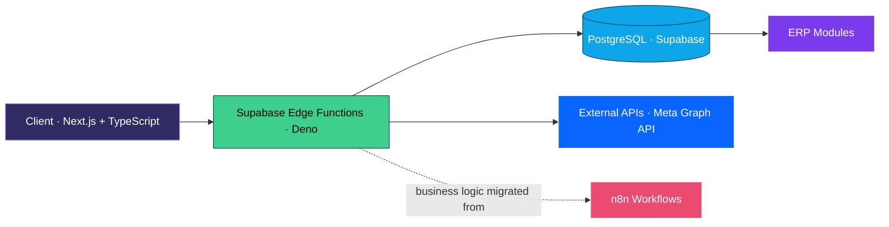
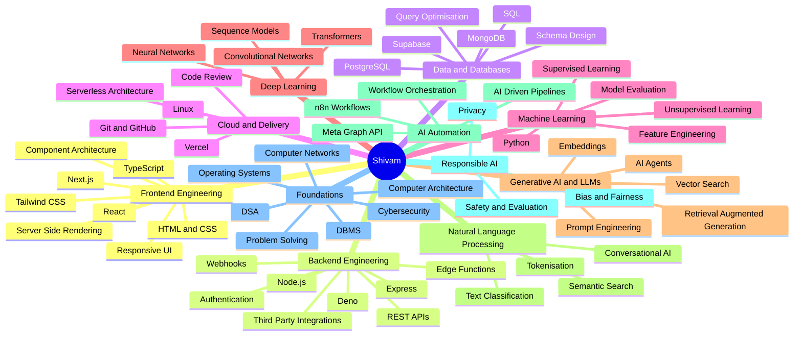
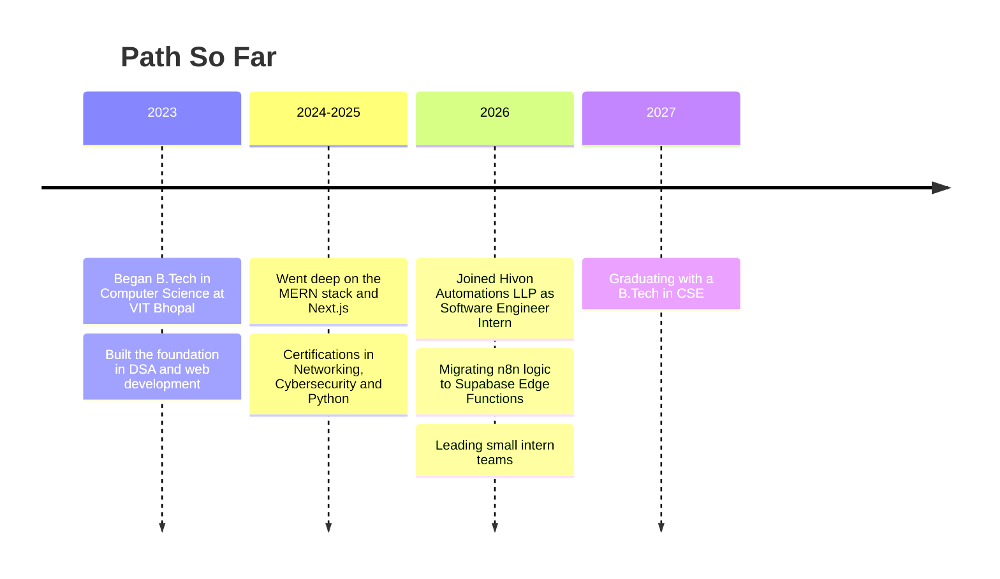

<div align="center">


<a href="https://git.io/typing-svg">
  
</a>

<br/><br/>


<br/><br/>

<a href="https://devshivammishra.vercel.app/"></a>
<a href="https://www.linkedin.com/in/devshivammishra"></a>
<a href="https://codeforces.com/profile/Shivam08"></a>
<a href="mailto:theshivammishra10@gmail.com"></a>
<a href="https://x.com/shivamM97963756"></a>

<br/><br/>


<br/><br/>

<sub>
<a href="#-executive-summary">Summary</a> &nbsp;·&nbsp;
<a href="#-experience">Experience</a> &nbsp;·&nbsp;
<a href="#-core-competencies">Competencies</a> &nbsp;·&nbsp;
<a href="#-engineering-impact">Impact</a> &nbsp;·&nbsp;
<a href="#-skill-map">Skill Map</a> &nbsp;·&nbsp;
<a href="#-beyond-the-code">Beyond the Code</a> &nbsp;·&nbsp;
<a href="#-tech-arsenal">Stack</a> &nbsp;·&nbsp;
<a href="#-github-analytics">Analytics</a> &nbsp;·&nbsp;
<a href="#-contact">Contact</a>
</sub>

</div>

<br/>


## ◈ Executive Summary

I'm a **Computer Science & Engineering undergraduate (VIT Bhopal, 2023–2027)** and **Software Engineer** who designs and ships **scalable, production-grade systems**. My work sits at the intersection of **software engineering, serverless architecture, workflow automation and AI-driven pipelines**.

I specialise in **Next.js · TypeScript · Supabase (PostgreSQL) · Deno Edge Functions · n8n**, and I care about the layer beneath the UI: **system design, performance, cost-efficiency and maintainable code**. Alongside that, I'm steadily deepening my knowledge of **machine learning and applied AI**.

> *"Strong fundamentals beat hype stacks."*

```text
 ┌────────────────────────────────────────────────────────────────────┐
 │  shivam@dev  ~  neofetch                                           │
 ├────────────────────────────────────────────────────────────────────┤
 │  Role         Software Engineer Intern                                   │
 │  Company      Hivon Automations LLP                                │
 │  Education    B.Tech CSE · Vellore Institute of Technology, Bhopal │
 │  Graduation   2027                                                 │
 │  Core         Next.js · TypeScript · Supabase · Deno · n8n         │
 │  Strengths    DSA · System Design · Backend · Automation           │
 │  Learning     Machine Learning · Advanced Backend Engineering      │
 │  Hobbies      Reading books on Artificial Intelligence             │
 │  Philosophy   Logic, scalability & clean code over hype            │
 │  Status       Online · Open to internships / full-time roles       │
 └────────────────────────────────────────────────────────────────────┘
```


## ◈ Experience

<table>
<tr>
<td width="100%">

### 🏢 Software Engineer Intern — **Hivon Automations LLP**
`Next.js` `TypeScript` `Supabase` `PostgreSQL` `Deno` `Edge Functions` `n8n` `ERP`

- **Architected a migration of business logic from n8n workflows to Deno-powered Supabase Edge Functions**, reducing unnecessary CPU consumption and moving toward a leaner, more cost-efficient ERP backend.
- **Built and optimised AI-driven workflows and automation pipelines** spanning Next.js frontends, Supabase data layers, and third-party integrations such as the **Meta Graph API**.
- **Led a small team of interns** — decomposed features into tasks, reviewed implementation approaches, and kept delivery aligned with architectural standards.
- Shaped **ERP system design** with a focus on modularity, maintainability and serverless-first execution.

</td>
</tr>
</table>



<sub><i>Simplified view of the architecture direction: logic moving from workflow-engine execution to lightweight, event-driven serverless functions.</i></sub>


## ◈ Core Competencies

<table>
<tr>
<td width="33%" valign="top">

**🖥 Frontend Engineering**
- React · Next.js (App Router, SSR/SSG)
- TypeScript · JavaScript (ES6+)
- Tailwind CSS · Responsive UI
- Performance & component architecture

</td>
<td width="33%" valign="top">

**⚙️ Backend & Serverless**
- Node.js · Express · REST API design
- Deno · Supabase Edge Functions
- Event-driven & serverless patterns
- Auth, validation, API integration

</td>
<td width="33%" valign="top">

**🗄 Data Layer**
- PostgreSQL · Supabase
- MongoDB · SQL
- Schema design & query optimisation
- DBMS fundamentals

</td>
</tr>
<tr>
<td width="33%" valign="top">

**🤖 AI & Automation**
- n8n workflow orchestration
- AI-driven pipelines
- Meta Graph API integrations
- Machine learning & generative AI (deepening)

</td>
<td width="33%" valign="top">

**🧮 CS Fundamentals**
- Data Structures & Algorithms
- Computer Architecture
- Computer Networks
- Cybersecurity basics

</td>
<td width="33%" valign="top">

**🛠 Engineering Practice**
- Git · GitHub · code review
- Vercel deployments · Linux
- Task decomposition & team leadership
- Clean, readable, scalable code

</td>
</tr>
</table>


## ◈ Engineering Impact

<div align="center">

<table>
<tr>
<td align="center" width="25%"><h3>n8n → Deno</h3><sub>Business logic migrated to<br/>Supabase Edge Functions</sub></td>
<td align="center" width="25%"><h3>↓ CPU</h3><sub>Reduced unnecessary compute<br/>by moving to serverless</sub></td>
<td align="center" width="25%"><h3>ERP</h3><sub>Contributing to a leaner,<br/>modular ERP backend</sub></td>
<td align="center" width="25%"><h3>Team Lead</h3><sub>Guiding a small intern team<br/>through design & review</sub></td>
</tr>
</table>

</div>

<!-- TIP: once you have real numbers (e.g. CPU reduction %, workflows migrated, endpoints shipped), replace the labels above with them. Metrics are the single biggest credibility boost on a profile. -->


## ◈ Tech Arsenal

<div align="center">

<sub><b>LANGUAGES</b></sub><br/>


<br/><br/>

<sub><b>FRONTEND</b></sub><br/>


<br/><br/>

<sub><b>BACKEND · DATA · RUNTIME</b></sub><br/>


<br/><br/>

<sub><b>TOOLING & DEPLOYMENT</b></sub><br/>


<br/><br/>


</div>


## ◈ Problem Solving

<table>
<tr>
<td width="70%" valign="top">

I practise **competitive programming** to keep my algorithmic thinking sharp — **graphs, dynamic programming, greedy, number theory, binary search and data-structure design** — and apply the same discipline to production code: reason about complexity first, then implement.

[](https://codeforces.com/profile/Shivam08)

</td>
<td width="30%" align="center" valign="middle">

`O(n log n)` mindset<br/>
<sub>correctness → complexity → clarity</sub>

</td>
</tr>
</table>


## ◈ Skill Map

<sub>Core strengths across software engineering, plus the AI fields I'm actively building depth in.</sub>




## ◈ Engineering Principles

<table align="center">
<tr>
<td align="center" width="25%"><h1>01</h1><b>Fundamentals First</b><br/><sub>Frameworks change. Data structures, systems and networks don't.</sub></td>
<td align="center" width="25%"><h1>02</h1><b>Performance Is a Feature</b><br/><sub>Less CPU, fewer round trips, leaner runtimes.</sub></td>
<td align="center" width="25%"><h1>03</h1><b>Readable Over Clever</b><br/><sub>Code is read far more often than it's written.</sub></td>
<td align="center" width="25%"><h1>04</h1><b>Lift the Team</b><br/><sub>Break down work, review together, ship together.</sub></td>
</tr>
</table>


## ◈ Beyond the Code

<table>
<tr>
<td width="12%" align="center" valign="middle"><h1>📚</h1></td>
<td width="88%" valign="top">

### Reading
I enjoy reading **books related to Artificial Intelligence** — how machines learn, how language models reason, and how this technology is reshaping the way we build software and live. It keeps my engineering grounded in the *why* behind the tools I use every day.

`Machine Learning` &nbsp; `Deep Learning` &nbsp; `Generative AI` &nbsp; `AI & Society` &nbsp; `Future of Software`

</td>
</tr>
</table>


## ◈ Roadmap




## ◈ GitHub Analytics

<div align="center">


<br/><br/>


<br/><br/>


<br/><br/>


<br/><br/>

<!-- Snake animation: requires the snake.yml GitHub Action to generate the `output` branch. -->
<picture>
  <source media="(prefers-color-scheme: dark)" srcset="https://raw.githubusercontent.com/Shivam30Mishra/Shivam30Mishra/output/github-snake-dark.svg"/>
  <source media="(prefers-color-scheme: light)" srcset="https://raw.githubusercontent.com/Shivam30Mishra/Shivam30Mishra/output/github-snake.svg"/>
  
</picture>

</div>


## ◈ Ask Me About

<div align="center">


</div>


## ◈ Contact

<div align="center">

**Open to internships, full-time roles and collaborations in software engineering, backend systems and AI-automation.**

<br/>

<a href="mailto:theshivammishra10@gmail.com"></a>
<a href="https://devshivammishra.vercel.app/"></a>
<a href="https://www.linkedin.com/in/devshivammishra"></a>

<br/><br/>


<br/><br/>

<sub>🦉 CodeOwl</sub>

</div>


